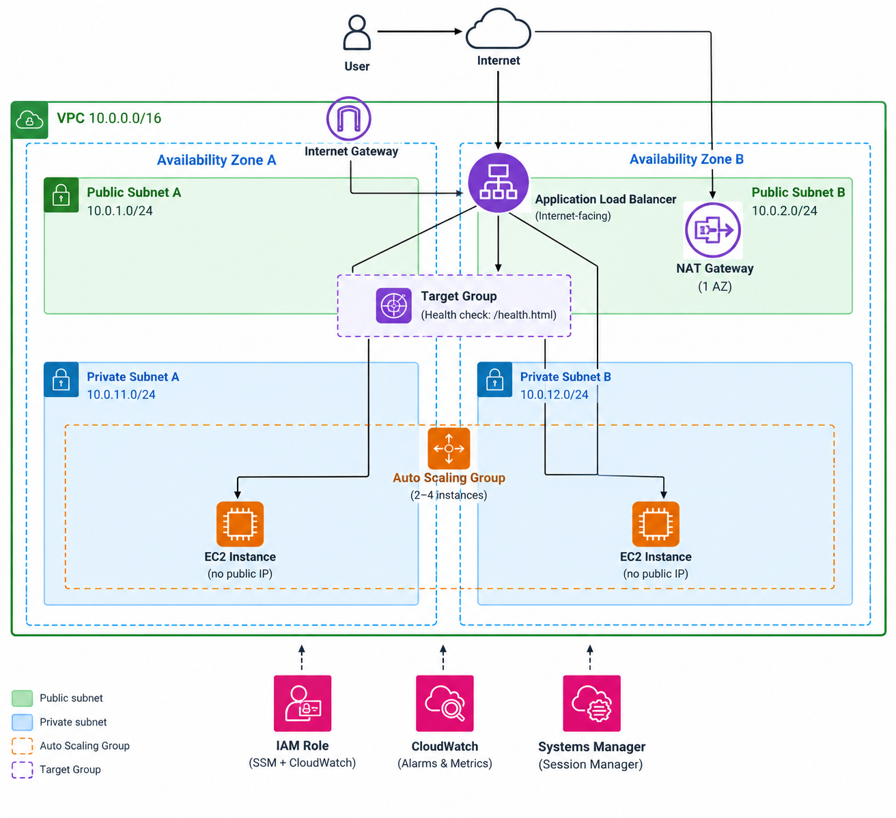
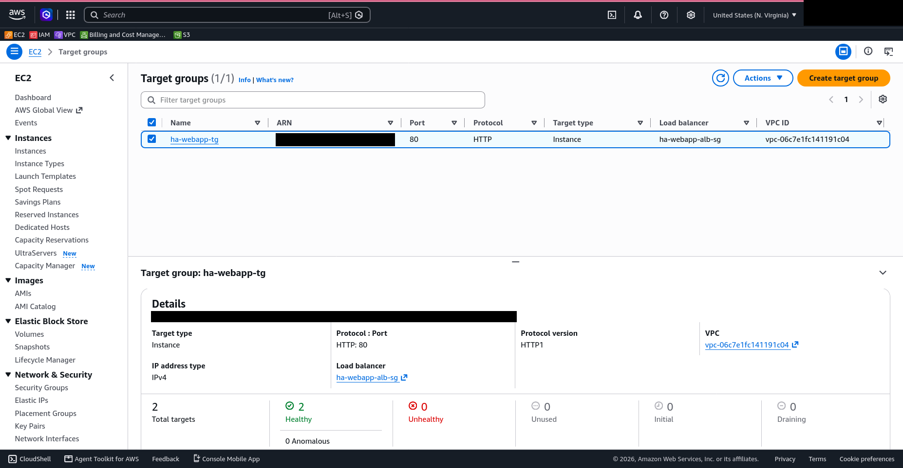
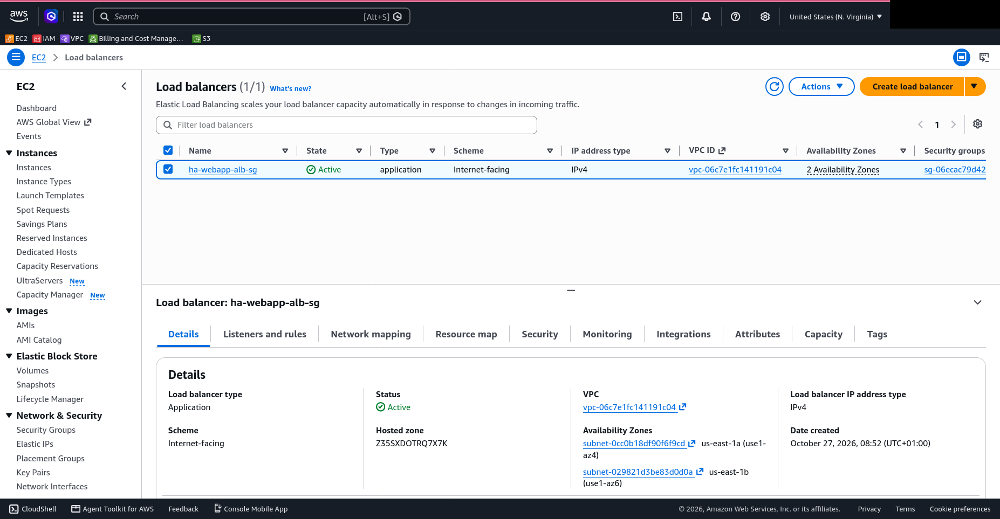
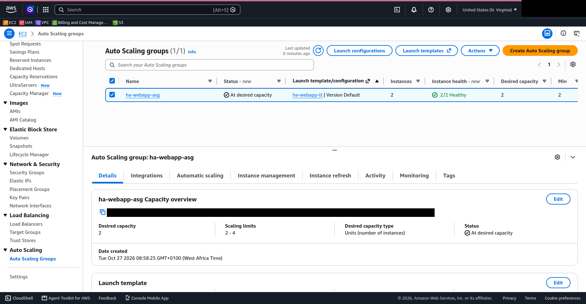
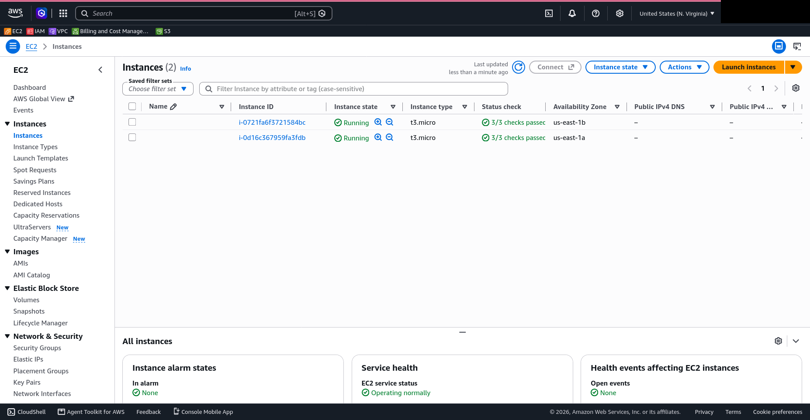
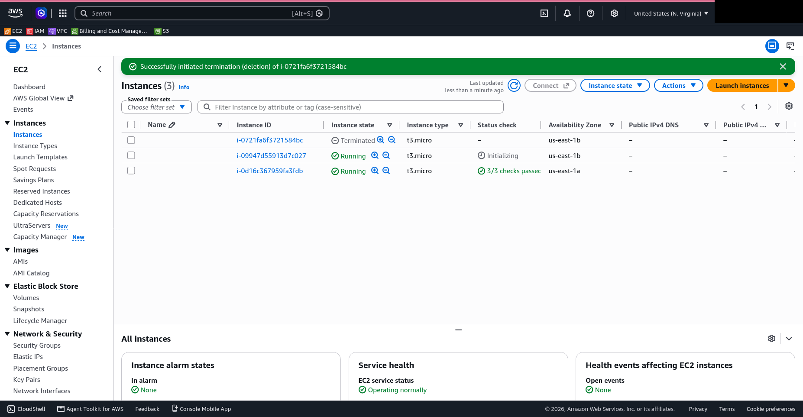

# Highly Available Web Application with Automatic Recovery

A web application on AWS that stays available when an application server fails, and recovers on its own without an administrator rebuilding anything.

The project does not just show that the site loads. It **demonstrates recovery from failure**: stopped services, terminated instances, a broken configuration and an Availability Zone loss, each with timestamps and evidence.

## Architecture

| Component | Purpose |
|---|---|
| VPC `10.0.0.0/16` | Isolated network across two Availability Zones |
| 2 public subnets | Hold the Application Load Balancer and the NAT gateway |
| 2 private subnets | Hold the web servers, with no public IPs |
| Internet gateway | Internet access for the public subnets |
| NAT gateway (1 AZ) | Outbound-only internet for the private instances (package installs, SSM) |
| Application Load Balancer | The only internet-facing component; spreads traffic and runs health checks |
| Target group | Checks `/health.html` on each instance every 15 seconds |
| Launch template | Defines every instance identically: AMI, type, security group, IAM profile, user data |
| Auto Scaling group | Keeps 2 to 4 instances running across both AZs and replaces unhealthy ones |
| IAM role | Limited to Systems Manager access and the CloudWatch agent |
| CloudWatch alarms | Alert on unhealthy hosts, low healthy host count and high CPU |

## Services used

VPC, EC2, Application Load Balancer, EC2 Auto Scaling, IAM, CloudWatch, Systems Manager (Session Manager).

## Screenshots

**Both targets Healthy in the target group**

**Internet-facing Application Load Balancer, Active across 2 Availability Zones**

**Auto Scaling group at desired capacity, 2/2 Healthy (limits 2 to 4)**

**Two instances, one per Availability Zone, with no public IPv4 address**

**Recovery: an instance was terminated and the ASG immediately launched a replacement**

## Design decisions

- **The ALB is the only internet-facing component.** Web servers have no public IPs.
- **Least privilege at the network layer.** The web security group accepts HTTP only from the ALB security group, never from the internet.
- **No SSH.** Port 22 is closed. Administration is through Session Manager.
- **ELB health checks on the Auto Scaling group.** An instance that is running but serving errors is replaced, not just one that has crashed.
- **Dedicated `/health.html` endpoint.** A lightweight check that does not depend on the website content.
- **Health check grace period of 300 seconds.** Gives a new instance time to install and start the web server.
- **Fast failure detection.** Interval 15s with an unhealthy threshold of 2 means detection in about 30 seconds.
- **Target tracking scaling on CPU (target 50%).** Adds capacity under load, up to 4 instances.
- **Scoped IAM role.** Only `AmazonSSMManagedInstanceCore` and `CloudWatchAgentServerPolicy`.

## Deployment

The user data script is in [scripts/user-data.sh](scripts/user-data.sh).

## Limitations

- **Single NAT gateway.** It lives in one AZ. If that AZ fails, running instances in the other AZ keep serving traffic, but **new** instances there cannot reach the internet to install packages, so replacement launches would fail their user data. Production would use one NAT gateway per AZ.
- **AZ failure reduces capacity.** The ALB keeps serving from the surviving AZ, but capacity is halved until the ASG launches replacements there (up to the maximum of 4).
- **HTTP only.** No HTTPS or custom domain. Production would add an ACM certificate and a Route 53 record.
- **No database or shared state.** Each instance serves static content.
- **Dependency on an external download.** User data downloads the website template at boot. A more robust design would bake an AMI or pull from S3.
- **Manual build.** Created through the console. Infrastructure as code (Terraform or CloudFormation) would make it repeatable.

## Troubleshooting

| Issue | Possible Cause | Solution |
|---|---|---|
| Website not loading | ALB or security group misconfiguration | Check ALB listeners and security group rules. |
| Target unhealthy | Nginx stopped or health check failing | Verify Nginx is running and `/health.html` is accessible. |
| User Data failed | Bootstrap script error | Check `/var/log/cloud-init-output.log` on the instance. |
| Session Manager unavailable | IAM role or connectivity issue | Verify the instance role and SSM connectivity. |

## Cost and Cleanup

AWS resources such as EC2, the Application Load Balancer, NAT Gateway, and EBS volumes may incur charges.

After testing:
1. Set the Auto Scaling Group's desired, minimum, and maximum capacity to `0`, then delete it.
2. Delete the Load Balancer and Target Group.
3. Delete the NAT Gateway and release any associated Elastic IP.
4. Terminate remaining EC2 instances and remove unused resources.
5. Check AWS Billing to confirm no unwanted resources remain.

## Future improvements

- HTTPS with ACM and Route 53
- One NAT gateway per AZ
- Bake a golden AMI (for example with EC2 Image Builder) to remove the boot-time download
- Rebuild with Terraform
- AWS WAF in front of the ALB
- SNS notifications on alarms

## Credits

Website template: Tooplate "Aperture" (<https://www.tooplate.com/>). Template files are not included in this repository.